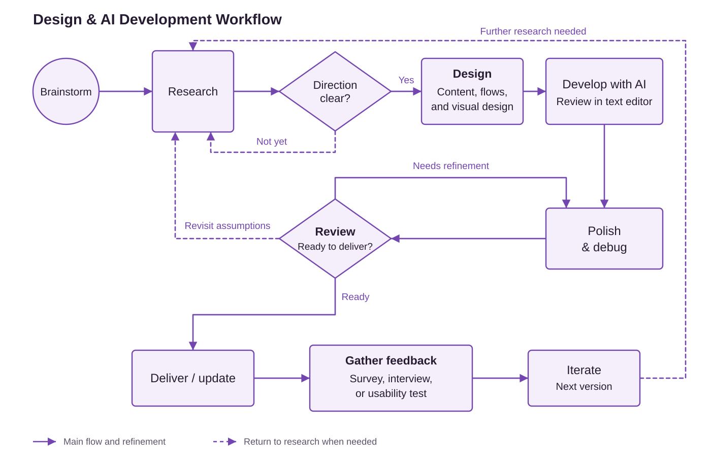
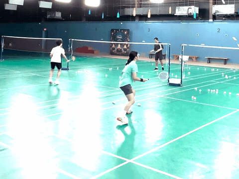

<picture>
  <source media="(prefers-color-scheme: dark)" srcset="assets/huiying-chung-wordmark-dark.svg">
  
</picture>

# Hi, I'm Huiying.

I'm a UX/UI and product designer with a background in visual communication. I make complex information easier to understand and use.

B.S. in Graphic Information Technology, Arizona State University — expected December 2026.

## Design process and AI collaboration

I start with user research and problem definition, then shape the content, user flows, and visual design. I set requirements, direct implementation, and evaluate usability. AI tools help generate, review, and revise code; I make the product and design decisions and guide revisions.

<a href="assets/design-process-light.svg">
<picture>
  <source media="(prefers-color-scheme: dark)" srcset="assets/design-process-dark.svg">
  
</picture>
</a>

## Award-winning projects

- [Where Dragons Dwell](https://www.huiyingchung.com/dragon-map-case-study.html) — 3rd place, Handshake × OpenAI Codex Creator Challenge (April 2026).
- [Kickoff Buddy](https://www.huiyingchung.com/kickoff-buddy-case-study.html) — Best Use of Technology, AI Builders Challenge by IBM and BeMyApp (June 2026).

## Selected work

- [Sky to Porch](https://www.huiyingchung.com/sky-to-porch-case-study.html) — Public hazard data explained in plain language, with sources.
- [Ways of Healing](https://www.huiyingchung.com/ways-of-healing-case-study.html) — An interactive atlas of culture, illness, and care.
- [Rehello](https://www.huiyingchung.com/re-hello-case-study.html) — A social memory app for remembering people and continuing conversations.
- [Openhall](https://www.huiyingchung.com/openhall-case-study.html) — A tool for turning artwork into a walkable 3D exhibition.

## Tools

- Design: Figma, Adobe Photoshop, Illustrator, Lightroom, Premiere Pro, InDesign, After Effects
- AI collaboration: Codex, Claude Code, IBM Bob, Gemini, Grok
- Development and publishing: GitHub, Vercel, VS Code, CodePen

## Personal interests

Outside of design, I enjoy badminton and road trips.

## Connect with me

[Portfolio and case studies](https://www.huiyingchung.com/) · [LinkedIn](https://www.linkedin.com/in/huiying-chung)
